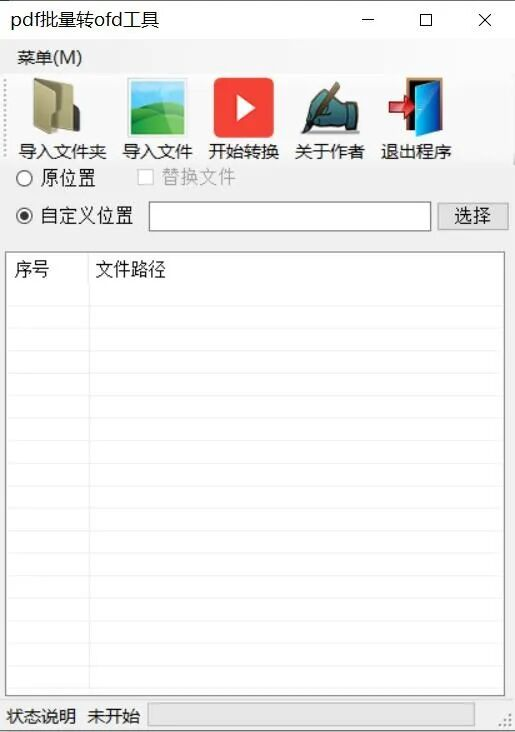

# PDF batch conversion to OFD locally offline, simple operation and supports Windows 10 and above systems.

This tool, specifically designed for Windows 10 and above systems, is a lightweight and efficient batch PDF to OFD conversion tool. It operates entirely offline, with all conversion calculations completed locally on the device. This effectively eliminates the risk of data leakage associated with uploading sensitive documents through cloud-based conversion tools, and it is unaffected by external factors such as network fluctuations or the suspension of cloud services. Even beginners without prior experience in format conversion can quickly complete the bulk processing of hundreds of documents using this simple operation process. It is important to reiterate that this tool only supports one-way conversion from PDF to OFD, and does not have the capability to perform the reverse conversion from OFD to PDF. Please do not attempt to convert OFD files to PDF, as this will result in an invalid task.

Insert image description here.

1. Pre-operation environmental verification and preparation

Before starting the tool, it is essential to confirm that your device's system version is Windows 10 or higher. Older systems running Win7 and below have compatibility issues with underlying components, preventing the normal loading of the tool's conversion kernel. Forced startup may result in abrupt crashes or conversion failures. Since the tool is designed fully offline, there is no need to connect to any WiFi or wired network before starting, nor does it silently scan or upload your local documents in the background. Even if you are importing sensitive government documents, corporate financial vouchers, or project confidential materials marked as internally classified, you can be assured that they will be processed securely, fully complying with local data processing requirements stipulated by the GDPR.
After completing the system verification, it is recommended to organize all the PDF files you need to convert into a single folder: If the number of files to be converted exceeds 20, it is best to consolidate them into a separate folder, named according to business categories, such as "2024 Project Archiving PDF" or "Financial Reimbursement Voucher Scanned," which will allow for a one-time load during the import process without the need for repeated operations. For individual files, you can also place them on the desktop for easy selection and import later. Additionally, it is advised to create a dedicated output folder for the converted OFD files in advance, avoiding direct use of the original PDF storage path to prevent future file confusion and avoid accidental overwriting of the original files.

II. Practical Details of Multi-Mode Import for Transformation of Files to be Converted

The tool is designed for different file organization scenarios and offers two fully compatible import methods, allowing you to freely choose based on your actual needs without being limited to a single operation path:
The first method is the "Import Folder" mode, which is the optimal choice for processing large volumes of files. Click on the "Import Folder" button at the top of the interface, which has a folder icon, in the pop-up Windows Explorer window. Select the PDF folder you have pre-collected and confirmed. The tool will automatically recursively scan all subdirectories within this path for PDF files. You do not need to manually select each one; even if there are multiple nested subfolders within the folder, all PDFs that meet the formatting criteria will be automatically extracted and loaded into the "Number - File Path" list in the center of the interface. A hundred or more files can be imported in just a few seconds, significantly improving efficiency over adding individual files one by one.
The second method is the "Import File" mode, suitable for scenarios where only a portion of scattered PDFs need conversion. Click on the "Import File" button with a document icon, and in the file selection popup window, you can either select the PDFs you need to convert one by one using the Ctrl key, or select multiple files consecutively using the Shift key. After confirming, these selected files will be added in order to the file list. After the import is complete, you can verify the file paths in the list line by line to ensure no irrelevant PDF files are mistakenly added, avoiding unnecessary conversion tasks and wasting system resources.

III. Fine-grained Output Path Settings Scheme

The tool provides three different output rules, covering the vast majority of office scenarios. You can flexibly choose based on the file's confidentiality level and archiving requirements:
The first option is the "Original Location" option. After checking this box, the OFD files generated will be directly saved to the same folder as the corresponding PDF, stored at the same path as the original PDF. This is suitable for scenarios where the classification of files is very clear and there is no need for centralized collection. After the conversion, you won't need to move the files manually; you can find the generated OFD version in its original location for easy comparison with the original PDF later.
The second option is the "Replace File" option, which must be highlighted for operational risks: Once activated, the generated OFD files will overwrite the original PDF without a confirmation dialog. Any mistake during this process could result in the loss of the original PDF. It is recommended to use this option only after completing a full backup of the original file. It is not recommended for general office scenarios.
The third option is the most commonly used "Custom Location" option. After selecting this option, the path input box on the right will be activated. You can click the "Select" button next to it, select the newly created output folder in the pop-up window, or directly enter the complete path of the target folder into the input box. After confirming, all converted OFD files will be consolidated into this designated directory, preventing them from being scattered across different disk paths. Subsequently, simply opening this folder will allow you to retrieve all completed documents in one go, making it very convenient for batch archiving and submitting to government systems.

IV. Execution of Conversion and General Precautions throughout the Process

After confirming that the file list is accurate and the output path has been set, click the "Start Transformation" button with the play icon at the top of the interface. The tool will automatically sort the files according to the list and load each PDF file for format conversion one by one. During the transformation process, the status bar at the bottom will update the current processing progress in real-time, displaying a dynamic prompt "Conversion of the Xth file in progress." You do not need to stay on the tool interface waiting; you can completely suspend the tool to handle other office tasks while it processes, without requiring manual supervision.
This tool's conversion kernel is deeply adapted to the domestic OFD layout standards. During the conversion process, it will fully preserve the original text layout, margins, image elements, and table structures of the PDF. Even for government documents with complex seals or special fonts, there will be no issues with content misalignment, garbled fonts, or missing images. The converted OFD files can be directly imported into most domestic government archiving systems and e-certification platforms without the need for further format adjustments.
If any individual files fail during the conversion process, the tool will not immediately interrupt the entire task. It will automatically skip the problematic files and continue with subsequent tasks. Once all tasks are completed, the status bar will indicate that the conversion is complete, and at the same time, it will mark the paths of the failed files in the list. You can open these problematic PDFs individually to troubleshoot and ensure they are not corrupted or encrypted before re-importing them for conversion separately.

V. Verification and concluding operations after conversion

After the entire conversion task is completed, open the output folder you have set up. First, verify the number of OFD files generated to ensure they match the total number of PDFs imported. Then, randomly select about 10% of the files and open them for verification. Check whether the content is complete and the layout matches the original PDF. If there are no issues, you can directly use these converted files for subsequent archiving and submission processes. If there are no other conversion needs later on, click the "Exit Program" button at the top right corner of the interface to safely close the tool. All imported task records will not be retained locally, further ensuring your document privacy is protected.
The entire process does not require complex parameter settings. Even office personnel who are new to format conversion can master batch operations within 3 minutes. Compared to online conversion tools that often require queueing, limited single-file size, or forced payment to unlock bulk functionality, this pure offline tool eliminates usage barriers and functional restrictions. It is the most efficient choice for handling PDF to OFD conversion needs in daily office work.

## Payment

Here is a pay link on Stripe ( https://buy.stripe.com/3cs8yP7sY87d0vu9AB ). Please contact me lonlonago@foxmail.com after funding $89, and I will send you a complete data files , thank you!

